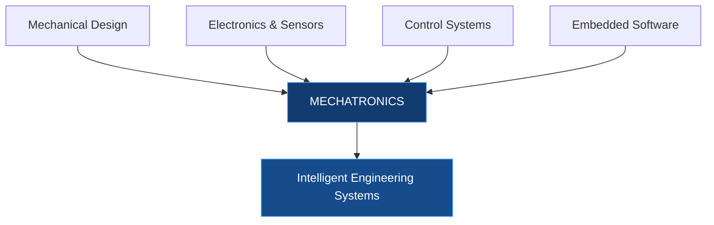
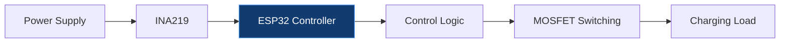
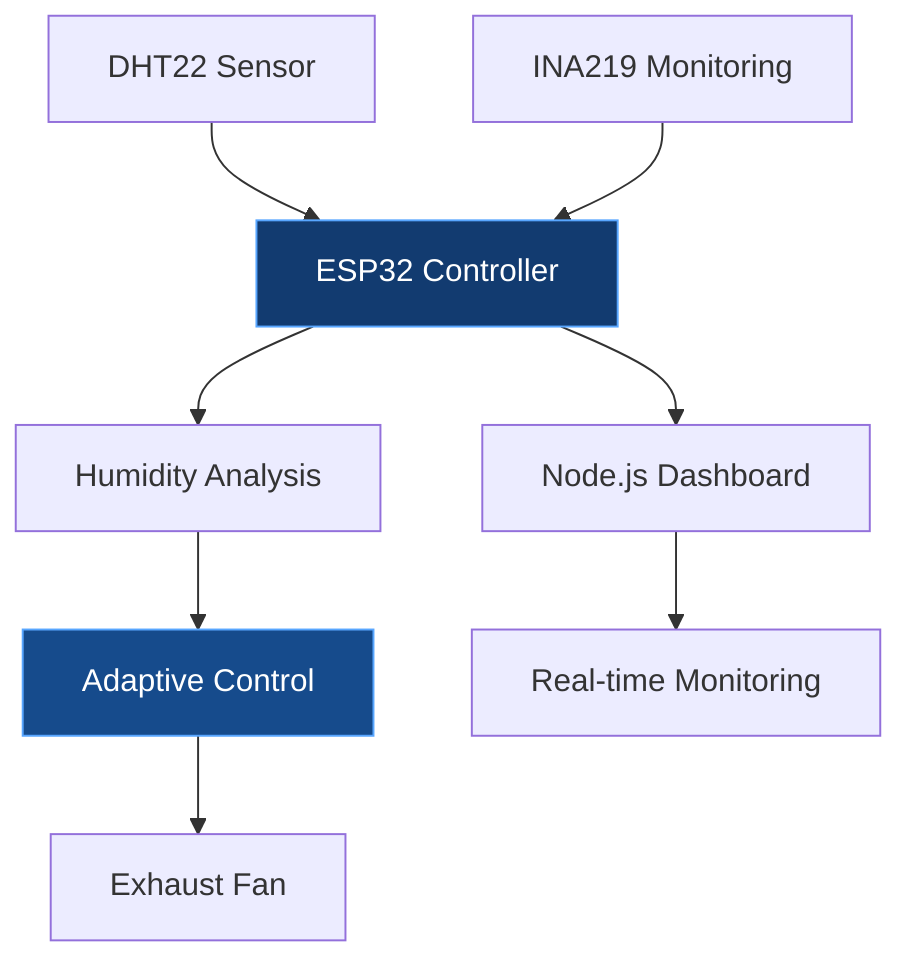
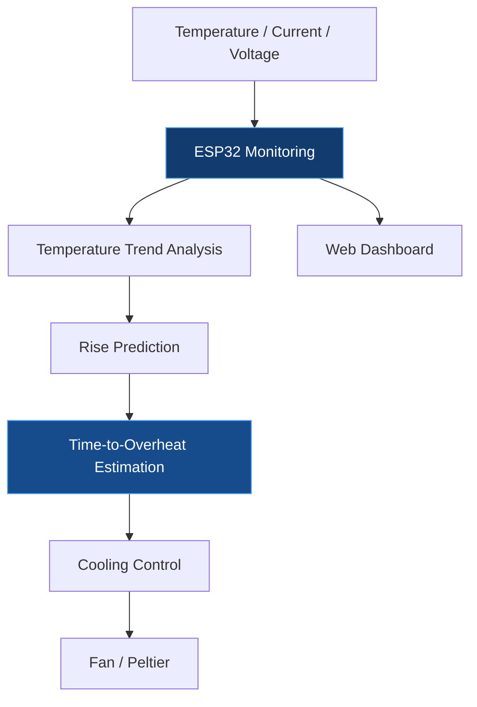

<!-- =====================================================
     KISHORE G | PROFESSIONAL ENGINEERING PORTFOLIO
     Design: Engineering Blue
====================================================== -->

  

  

  
  
  

---

## 01. Engineering Profile

I am a **Mechatronics Engineering undergraduate at Chennai Institute of Technology**, interested in designing and developing intelligent engineering systems through the integration of mechanical engineering, electronics, control systems and software.

My work focuses on embedded systems, robotics, industrial automation, intelligent monitoring and engineering prototyping.

I enjoy approaching engineering problems from both hardware and software perspectives, from mechanical design and sensor integration to control logic and real-time visualization.

**Education:** B.E. Mechatronics Engineering  
**Institution:** Chennai Institute of Technology  
**CGPA:** 8.72

---

## 02. Engineering Philosophy

  
  

  
  

My approach is to integrate engineering disciplines into functional systems rather than treat them as isolated technologies.

---

## 03. Technical Capabilities

### Programming

  

### Robotics & Industrial Automation

  
  
  
  
  

### Mechanical Design & Simulation

  
  
  
  

### Embedded Systems & Electronics

  
  
  
  

### Software & Development Tools

  

---

## 04. Selected Engineering Projects

Projects focused on embedded control, intelligent monitoring, power management and thermal systems.

### 01 / VoltEdge

**Adaptive EV Charging and Grid Load Management System**

EV TECHNOLOGY · POWER MONITORING · EMBEDDED CONTROL

Developed an adaptive EV charging prototype focused on grid load management.

**Engineering contributions**

- Implemented ESP32-based power monitoring using the INA219 sensor.
- Developed threshold-based charging control through a MOSFET module.
- Evaluated hardware alternatives and estimated component costs.
- Tested system response using 12V DC fan and LED loads.

**Technology stack**

`ESP32` `INA219` `MOSFET` `IoT`

---

### 02 / AeroVent

**Intelligent Demand-Controlled Exhaust Ventilation System**

INTELLIGENT CONTROL · ENVIRONMENTAL MONITORING · IoT

Developed an intelligent exhaust ventilation prototype using humidity-level and rate-of-rise detection to automate fan operation.

**Engineering contributions**

- Implemented humidity-level and rate-of-rise detection.
- Developed adaptive humidity recovery logic.
- Integrated sensor-failure detection with fail-safe fan control.
- Implemented INA219-based electrical monitoring.
- Connected ESP32 with a Node.js and Socket.IO dashboard for real-time environmental data, system status and fault notifications.

**Technology stack**

`ESP32` `DHT22` `INA219` `MOSFET` `Node.js` `Socket.IO`

---

### 03 / STEMS

**Smart Thermal Energy Management System**

THERMAL MANAGEMENT · PREDICTIVE ANALYSIS · EMBEDDED SYSTEMS

Developed an intelligent battery thermal management system that monitors temperature, current and voltage in real time.

**Engineering contributions**

- Implemented real-time temperature, current and voltage monitoring.
- Developed temperature-trend analysis and temperature-rise prediction.
- Implemented time-to-overheat estimation.
- Integrated dynamic fan and Peltier cooling control.
- Developed a real-time dashboard for sensor visualization, predictive insights and cooling-status monitoring.

**Technology stack**

`ESP32` `Node.js` `Socket.IO` `HTML` `CSS` `JavaScript`

---

## 05. Professional Experience

### Royal Enfield

**Industrial Maintenance Intern | May 2026 – June 2026**

Chennai, India

- Observed motorcycle manufacturing operations across machine shop, engine assembly, paint shop and vehicle assembly departments.
- Gained exposure to industrial machinery, automation systems, quality inspection and surface-finishing processes.
- Studied industrial maintenance practices.
- Worked on a Smart Industrial Air Compressor Monitoring and Alert System using LoRa communication, focused on pressure monitoring and abnormal-condition alerts.

### MAS Robotics Pvt. Ltd.

**Robotics & Automation Intern | June 2025 – July 2025**

Chennai, India

- Contributed to an automated tyre-painting robot project.
- Worked on pick-and-place mechanisms, simulation, electrical panel building and mechanical assembly.
- Designed components using SolidWorks.
- Gained practical exposure to industrial sensors, electrical drives and device integration.

---

## 06. Achievements

<table>
<tr>
<td width="50%" align="center">
<h3>🥈 2nd Prize</h3>
<strong>EcoVerse 2026</strong>
 
VIT Chennai
  
ML-based Activity Recognition System
</td>
<td width="50%" align="center">
<h3>Top 7</h3>
<strong>Central India Hackathon 3.0</strong>
 
SDG 3 Track
  
Among 800+ participating teams
</td>
</tr>
</table>

---

## 07. Education

| Qualification | Institution | Period |
|---|---|---|
| B.E. Mechatronics Engineering | Chennai Institute of Technology | 2024 – Present |
| Diploma in Programming – BS Degree | IIT Madras | 2025 – Present |

**Current CGPA:** 8.72

---

## 08. Courses & Certifications

| Provider | Course | Score / Status |
|---|---|---|
| NPTEL | Introduction to the Internet of Things | 76% |
| NPTEL | Cloud Computing | 68% |
| NPTEL | Microrobotics | 75% |
| Udemy | Siemens S7-1200 PLC & HMI using TIA Portal | Completed |
| MathWorks | MATLAB Onramp | Completed |
| MathWorks | Simulink Onramp | Completed |
| IIT Madras | BS Foundation Level | Completed |

---

## 09. Current Technical Focus

- **Robotics:** ROS 2, motion planning and simulation.
- **Intelligent Systems:** Computer vision and machine learning.
- **Automation:** PLC programming and industrial control.
  
---

## 10. Connect

  
  
  

  <strong>Engineering ideas into intelligent systems.</strong>

  

